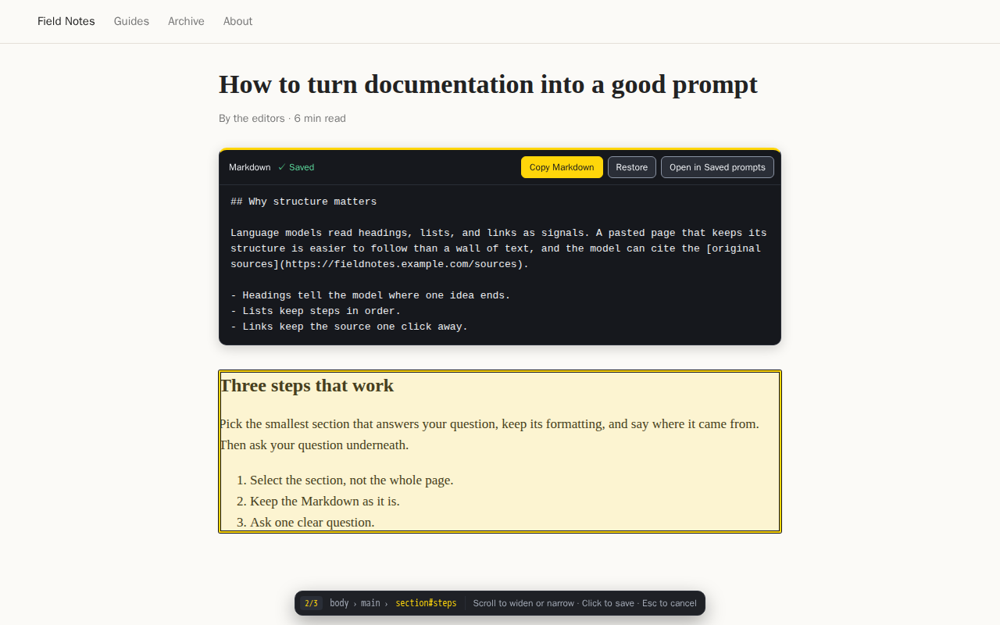

# WebsiteToPrompt

A free, open-source Chrome extension that helps you convert webpage content into well-formatted prompts for ChatGPT or any other AI tool. It preserves headers, lists, links, and other text formatting, ensuring your AI conversations remain clear and structured.

## 1. Generating Prompts from Any Webpage

## 2. Sorting, Searching, and Visiting Snippets

## Features

1. **One-Click Selection Mode**:
   - Toggle Selection Mode to hover over any paragraph, list, or section.
   - Click to capture content, automatically converting it to clean Markdown.
   - Retains original layout without random line breaks or missing headers.

2. **Personal Prompt Library**:
   - Each selected snippet saves to a private library within the extension.
   - Uses Chrome's local storage - no complicated setup needed.
   - Everything stays on your device unless explicitly copied elsewhere.

3. **Prompt Management Dashboard**:
   - Categorize prompts by website domain or capture date
   - Quick search and filter functionality
   - Bulk actions: Select multiple snippets to copy or delete
   - View, manage, and export your saved content

4. **Format Preservation**:
   - Maintains headers, lists, and clickable links
   - Clean, structured output for better AI processing
   - Perfect for ChatGPT, documentation, or research notes

5. **Privacy & Security**:
   - Open-source code available on GitHub
   - Local storage only - your data stays on your device
   - No personal information collected or sold

## Installation

1. Install from the Chrome Web Store
2. Pin the extension to your toolbar
3. Enable Selection Mode on any webpage
4. Start capturing content with a single click

## How to Use

1. Click the extension icon and choose **Enable Selection** (or right-click the page and choose **Select content to convert**)
2. Hover over the content you want. Scroll to step out to a parent element, and press Esc to cancel
3. Click to capture. The element turns into its Markdown, with **Copy**, **Revert**, and **Open Dashboard** buttons
4. Access your saved prompts through the Dashboard where you can:
   - Search by URL or content
   - Delete unwanted prompts
   - Select several snippets (Shift or Cmd/Ctrl click) and copy them as one prompt, each wrapped in a `<website_section>` tag

## Technical Details

- Built on [Turndown](https://github.com/domchristie/turndown) for HTML-to-Markdown conversion
- Uses Chrome's local storage API for data persistence
- Links and images are written with absolute URLs, and link text stays on one line

## Development

There is no compile step. `src/` is the complete extension.

1. Open `chrome://extensions`, turn on **Developer mode**, click **Load unpacked**, and choose `src/` (or `dist/` after `npm run build`).
2. After an edit, click the extension's reload button.
3. `npm run build` copies `src/` to `dist/`. `npm run pack` also writes `WebsiteToPrompt.zip` for the Chrome Web Store.
4. `npm test` loads `src/` into Playwright's Chromium inside Docker and runs `tests/e2e.js`: capture, links, revert, saves, and the dashboard.
